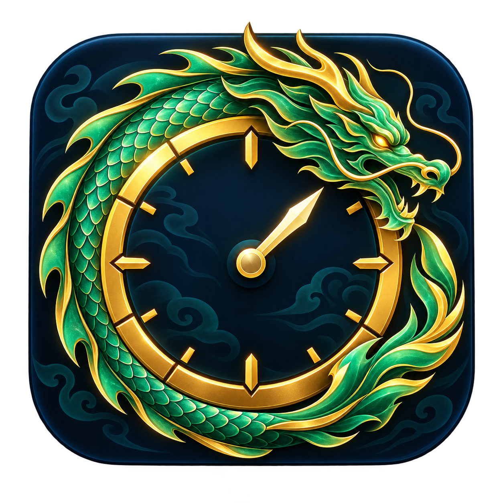

# Martial Arts World Tracker

**By Yuu · Windows · V1.3.1**

A desktop overlay that reads visible boss timers and announcements while you play. Track respawns, special boss events, and Chaos / Void Qi locations in one HUD.

## Download and play

1. Open this repository's **Releases** section.
2. Download **Martial-Arts-World-Tracker-V1.3.1-Windows.zip**.
3. Right-click the ZIP and choose **Extract All**.
4. Open the extracted folder and double-click **Martial Arts World Tracker.exe**.

No Python installation or setup command is needed. Keep the `_internal` folder beside the executable. Use the Windows release ZIP; GitHub's automatic **Source code** downloads are for development.

## First run

Open Roblox and return to the game window. The green indicator means scanning is active; yellow means the game is not focused. Three trackers start pinned; open **Index** to choose more from the included 50-entry library. Timers start at **Need entry** until the app reads a timer or an announcement. Wukong waits for a notification.

- **Ctrl + Alt + T** toggles lock/unlock. The unlock control also provides **Exit**.
- **Index** manages names, aliases, colors, regions, pins, and timers.
- **Presets** saves and loads your tracker selection.
- **Set Timer**, inside Index → Edit, accepts `3`, `3.50`, and `3:50`.
- Resize the HUD and Index independently. Sides change width, the bottom reveals more entries, and corners scale that window.
- Use **Reset** when changing servers.

## Detection

The screen capture target is every 0.5 seconds. Center announcements, side notifications, and world labels are processed independently. Difficult small text, fog, and initial full-screen searches can take longer. The app reads visible screen pixels; it does not modify the game or automate gameplay. OCR runs locally with bundled models; the app has no account login or telemetry.

A detected defeat restarts the saved cooldown with the three-second delay correction. Special rules cover the Kraken altar, Sleeping Colossus, Sword Wraith, and notification-only Wukong. Chaos / Void Qi includes location text and exhaustion alerts.

The included catalog is community configured; cooldowns are editable and should be checked against the current game.

## Your data

Your settings, presets, and boss edits are saved in `settings.json` beside the executable. A backup may appear as `settings.before-tracker.json`. Keep the extracted folder somewhere writable, such as Documents. For an upgrade, close both versions and copy your own `settings.json` into the new extracted folder before opening it. Do not publish that file when sharing the app.

## Development

See [Build instructions](docs/BUILD.md). Source, tests, and assets are organized separately. No game screenshots or user settings are included.

## License

Application code: [MIT](LICENSE), copyright 2026 Yuu. Dependencies retain their [own licenses](THIRD_PARTY_NOTICES.md). This is an independent fan-made utility.
